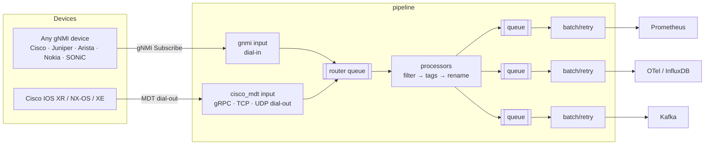

# *pipeline*: network telemetry collector

[](https://github.com/sangmeshcp/bigmuddy-network-telemetry-pipeline/actions/workflows/ci.yml)
[](https://sangameshpatil.com/bigmuddy-network-telemetry-pipeline/)

*pipeline* is an all-batteries-included collector for **model-driven
streaming telemetry** from network devices. It subscribes to devices over
**gNMI** (any vendor) or accepts **Cisco MDT dial-out**, normalises
everything into one vendor-neutral metric model, optionally filters and
enriches it, and delivers it to **Prometheus**, **OpenTelemetry (OTLP)**,
**InfluxDB**, **Kafka** or files.

📖 **Full documentation:** <https://sangameshpatil.com/bigmuddy-network-telemetry-pipeline/>
(source in [`docs/`](docs/)).

> *pipeline* was first released by Cisco in 2016 as an IOS XR-specific
> collector. It was rebuilt in 2026 around gNMI, OpenTelemetry and modern Go.
> [What changed and why, and how to migrate](docs/about/modernization.md).

---

- [Architecture](#architecture)
- [Quickstart](#quickstart)
- [Inputs](#inputs)
- [Processing](#processing)
- [Outputs](#outputs)
- [Monitoring the pipeline](#monitoring-the-pipeline)
- [Deployment](#deployment)
- [For developers](#for-developers)

---

## Architecture



1. **Inputs** speak to devices. Each device runs in its own goroutine and
   reconnects by itself. Everything received becomes a
   **Metric**: a *name* (schema path), *tags* (list keys, source device,
   subscription), *fields* (leaf values) and a *timestamp*.
2. The **router** runs the processors in order, then offers every metric to
   every output.
3. **Outputs** each have their own queue and worker that batch, write and
   retry.

Two properties matter in production:

- **Backpressure, not silent loss, at ingest.** When the router queue is
  full, inputs stop reading, so gRPC/TCP flow control slows the device down
  instead of the collector dropping data internally.
- **Isolation at egress.** A slow or failed destination fills only its own
  queue; its overflow is dropped and counted
  (`pipeline_output_dropped_total`) while every other output keeps flowing.

More in [Architecture](docs/concepts/architecture.md) and
[Data model](docs/concepts/data-model.md).

## Quickstart

Requires Go 1.26.11+. No router needed: the repo ships real IOS XR captures
and a replay tool.

```bash
git clone https://github.com/sangmeshcp/bigmuddy-network-telemetry-pipeline.git
cd bigmuddy-network-telemetry-pipeline
make build

cat > quickstart.yaml <<'EOF'
admin: {listen: "127.0.0.1:9180"}
inputs:
  - {name: dialout, type: cisco_mdt, transport: grpc, listen: "127.0.0.1:57500"}
outputs:
  - {name: prom, type: prometheus, listen: "127.0.0.1:9273", string_fields: info}
EOF

./bin/pipeline -config quickstart.yaml &
go run ./cmd/mdt-replay -addr 127.0.0.1:57500 internal/input/ciscomdt/testdata/*.kvgpb
sleep 2   # outputs flush once per second
curl -s 127.0.0.1:9273/metrics | grep generic_counters_bytes_received | head -3
kill %1   # stop the pipeline
```

The [Quickstart guide](docs/getting-started/quickstart.md) explains each step.
To run the pipeline with Prometheus and Grafana:
`cd deploy/compose && docker compose up --build`.

## Inputs

Any number of inputs of any type can run side by side.

### gNMI (dial-in, any vendor)

The pipeline connects to each device, sends a gNMI `Subscribe` (STREAM mode)
and holds the stream open, redialling with jittered exponential backoff when
it breaks. It supports `sample`, `on_change` and `target_defined`
subscriptions, TLS and mutual TLS, username/password, and `proto`,
`json_ietf` or `json` encodings.

```yaml
inputs:
  - name: core
    type: gnmi
    targets:
      - {address: core1.example.net:57400, name: core1}
      - core2.example.net:57400
    username: telemetry
    password: ${GNMI_PASSWORD}
    tls: {enabled: true, ca_file: /etc/pipeline/ca.pem}
    subscriptions:
      - {name: if-counters, path: /interfaces/interface/state/counters, sample_interval: 10s}
      - {name: if-status, path: /interfaces/interface/state/oper-status, mode: on_change}
```

### Cisco MDT (dial-out)

IOS XR, NX-OS and IOS XE devices configured for model-driven telemetry
dial-out connect to the pipeline over **gRPC**, **TCP** or **UDP** (the last
two with Cisco's 12-byte "ST" framing). It accepts self-describing GPB
(KV-GPB) and JSON payloads.

```yaml
inputs:
  - {name: xr, type: cisco_mdt, transport: grpc, listen: ":57500"}
```

```
telemetry model-driven
 destination-group PIPELINE
  address-family ipv4 192.0.2.10 port 57500
   encoding self-describing-gpb
   protocol grpc no-tls
 sensor-group IF
  sensor-path Cisco-IOS-XR-infra-statsd-oper:infra-statistics/interfaces/interface/latest/generic-counters
 subscription S1
  sensor-group-id IF sample-interval 10000
  destination-id PIPELINE
```

> Compact GPB (`encoding gpb`) needs per-model schemas compiled into the
> collector and is not supported; use `self-describing-gpb`.

All input options: [docs/configuration/inputs.md](docs/configuration/inputs.md).
Per-vendor device setup: [Connect your first device](docs/getting-started/first-device.md).

## Processing

gNMI and MDT data is hierarchical. The pipeline shapes it automatically:
updates are grouped per list instance, list keys become tags, and leaves
become fields:

```
/interfaces/interface[name=Ethernet1]/state/counters/in-octets = 1234
                         ↓
name:   openconfig:/interfaces/interface
tags:   source=core1  subscription=if-counters  interface_name=Ethernet1
fields: state/counters/in-octets=1234
```

Processors then run in order:

```yaml
processors:
  - type: filter                      # keep only what you need
    exclude_tags: {interface_name: ["^Null", "^Loopback"]}
    drop_fields: ["description$"]
  - type: tags                        # enrich with inventory
    sources: {core1: {site: dfw1, role: spine}}
    add: {env: prod}
  - type: rename                      # match your dashboards
    fields: [{match: "^state/counters/", replace: ""}]
```

Details: [docs/configuration/processors.md](docs/configuration/processors.md).

## Outputs

Every output gets its own queue, batching (`batch_size`, `flush_interval`)
and retries (`max_retries`), and classifies errors as transient (retried) or
permanent (dropped and logged).

### Prometheus

A scrape endpoint holding the latest value of each series, with automatic
expiry of series that stop updating:

```yaml
outputs:
  - {name: prom, type: prometheus, listen: ":9273", expiry: 5m, string_fields: info}
```

```
interfaces_interface_state_counters_in_octets{interface_name="Ethernet1",source="core1",subscription="if-counters"} 1234
interfaces_interface_state_oper_status_info{interface_name="Ethernet1",source="core1",subscription="if-status",value="UP"} 1
```

### OpenTelemetry (OTLP)

Push over gRPC or HTTP to an OpenTelemetry Collector, **Prometheus 3's native
OTLP receiver**, Grafana Mimir/Cloud, Datadog, Elastic, Splunk and others.
Each device becomes an OTel Resource.

```yaml
outputs:
  - {name: otel, type: otlp, endpoint: "otel-collector:4317"}
  - {name: prom-push, type: otlp, protocol: http, endpoint: "http://prometheus:9090/api/v1/otlp/v1/metrics"}
```

### InfluxDB

Line protocol to InfluxDB 2.x/3.x (token auth) or 1.x, and compatible stores
such as VictoriaMetrics, QuestDB and GreptimeDB:

```yaml
outputs:
  - {name: influx, type: influxdb, url: "http://influxdb:8086", org: netops, bucket: telemetry, token: "${INFLUX_TOKEN}"}
```

```
openconfig:/interfaces/interface,interface_name=Ethernet1,source=core1 state/counters/in-octets=1234u 1764000000000000000
```

### Kafka

JSON records keyed by device, so each device's data stays ordered within a
partition. Supports zstd/lz4/snappy/gzip, idempotent production, SASL
(PLAIN/SCRAM) and TLS. Kafka is the bus for feeding Elasticsearch, Splunk,
Flink, data lakes or your own consumers.

```yaml
outputs:
  - {name: bus, type: kafka, brokers: ["kafka:9092"], topic: network.telemetry}
```

```json
{"name":"openconfig:/interfaces/interface","tags":{"interface_name":"Ethernet1","source":"core1"},"fields":{"state/counters/in-octets":1234},"timestamp":"2026-11-24T09:00:00Z"}
```

### File

JSON lines to a file or stdout (`path: "-"`). Useful for seeing exactly what
the pipeline produces.

All output options: [docs/configuration/outputs.md](docs/configuration/outputs.md).

## Configuration essentials

- One YAML file: `pipeline -config pipeline.yaml`. The annotated reference is
  [`examples/pipeline.yaml`](examples/pipeline.yaml).
- **Strict**: unknown keys are errors. Validate with `pipeline -check`.
- **Secrets** never go in the file: use `${ENV_VAR}` (`${VAR:-default}`
  supported; an unset variable is a start-up error) or the `*_file` options
  for Kubernetes/Docker secrets.
- **TLS** works the same on every plugin through one `tls:` block (server
  auth, mTLS, custom CA, SNI).

See [Configuration overview](docs/configuration/overview.md).

## Monitoring the pipeline

The admin endpoint (`admin: {listen: ":9180"}`) serves `/healthz`,
`/readyz` and `/metrics`:

| Metric | Watch for |
|---|---|
| `pipeline_input_metrics_total{input}` | ingest rate per input |
| `gnmi_target_up{input,target}` | 0 = subscription down |
| `gnmi_session_failures_total` | reconnect churn |
| `mdt_connections`, `mdt_decode_errors_total{reason}` | dial-out sessions; `compact_gpb` = wrong device encoding |
| `pipeline_router_queue_batches` | sustained > 0 = processing bottleneck |
| `pipeline_output_written_total` / `pipeline_output_dropped_total{reason}` | delivery health per output |
| `pipeline_output_write_duration_seconds` | destination latency |

Recommended alert rules and queries:
[Monitoring the pipeline](docs/operations/monitoring.md).

## Deployment

| | |
|---|---|
| **Binary** | [Download a release](https://github.com/sangmeshcp/bigmuddy-network-telemetry-pipeline/releases) (linux/darwin, amd64/arm64, signed, with SBOMs) or `make build`; systemd unit in the [install guide](docs/getting-started/installation.md) |
| **Container** | `ghcr.io/sangmeshcp/telemetry-pipeline`: multi-arch, distroless, non-root, ~20 MB, cosign-signed |
| **Compose lab** | [`deploy/compose`](deploy/compose): pipeline + Prometheus 3 + Grafana |
| **Kubernetes** | Helm chart [`deploy/helm/telemetry-pipeline`](deploy/helm/telemetry-pipeline) (`oci://ghcr.io/sangmeshcp/charts/telemetry-pipeline`): config validated at deploy, rolling config updates, probes, hardened, ServiceMonitor |

Scaling, sizing and the security checklist: [Deployment](docs/operations/deployment.md).
Common problems: [Troubleshooting](docs/operations/troubleshooting.md).

## For developers

New to the project? Start with **[Developer onboarding](docs/development/onboarding.md)**.
It covers background reading, setup, a repository tour, conventions and your
first PR.

```bash
make build            # bin/pipeline
make test             # unit tests (no Docker or network needed)
make lint             # gofmt, go vet, staticcheck
make race             # tests with the race detector
make integration      # real InfluxDB / Kafka / Prometheus / gNMI targets (env-gated)
make smoke            # build the image, run it, replay captured data, verify
```

```text
cmd/pipeline/         entry point              internal/telemetry/   Metric model
cmd/mdt-replay/       replay tool              internal/pipeline/    plugins, router, workers
internal/input/       gnmi, ciscomdt           internal/config/      YAML, env, secrets
internal/processor/   filter, tags, rename     internal/output/      prometheus, otlp, influxdb, kafka, file
integration/          real-backend tests       docs/                 documentation site
```

**Testing** is layered: unit tests with in-memory fakes; a gNMI conformance
suite against the **OpenConfig reference gNMI target** (vendor-neutral);
integration tests against real InfluxDB, Kafka and Prometheus; and a container
smoke test. CI runs all of them on every pull request; see
[Testing & CI](docs/development/testing.md).

Adding an input, processor or output takes one Go type and one `Register`
call: [Writing a plugin](docs/development/writing-plugins.md).

See [CONTRIBUTING.md](CONTRIBUTING.md) for how to submit changes.

## License

Apache 2.0, see [LICENSE](LICENSE).
