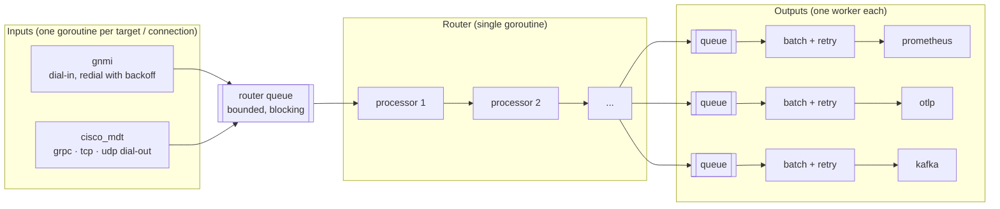
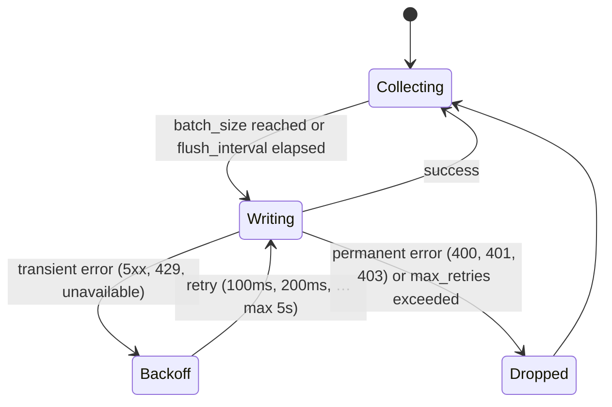

# Architecture

## The big picture

Data flows left to right through three stages.

1. **Inputs** talk to devices and turn whatever arrives (gNMI notifications,
   KV-GPB, JSON) into [`telemetry.Metric`](data-model.md) values.
2. **Router**: one goroutine takes batches off the router queue, runs them
   through the processors in configured order, then offers every surviving
   metric to every output's queue.
3. **Outputs**: each has its own queue and worker that batches metrics, writes
   them, and retries failures.

Inputs never know about outputs, and outputs never know which device or
vendor produced a metric. That separation is what lets one Prometheus
exporter serve data from Juniper gNMI and Cisco MDT side by side.

## Flow control and failure isolation

The two queues behave differently on purpose.

| Queue | When full | Why |
|---|---|---|
| **Router queue** (`router.queue_size`, default 1024 batches) | Inputs **block** | Blocking stops the input reading from its socket. gRPC/TCP flow control then pushes back on the device instead of the collector silently losing data. |
| **Output queue** (`queue_size`, default 100 000 metrics per output) | New metrics for **that output only** are **dropped** and counted | One slow or broken destination must never stall the rest. If Kafka is down, Prometheus keeps getting fresh data. |

Drops are always visible:
`pipeline_output_dropped_total{output="…",reason="queue_full"}`.

An output can instead use a **durable disk queue** (`queue: {type: disk}`):
data survives restarts and destination outages, and when the queue is full
the *oldest* data is dropped (`reason="disk_full"`). See
[durable disk queues](../configuration/overview.md#durable-disk-queues).

## Batching and retries

Each output worker collects metrics until it has `batch_size` of them or
`flush_interval` has passed, then calls the output's `Write`.

Outputs classify their own errors. An HTTP 400 from InfluxDB will never
succeed on retry, so it is marked *permanent* and dropped immediately; an
HTTP 503 is retried.

## Lifecycle

| Phase | What happens |
|---|---|
| **Start** | Config is parsed and validated. Every plugin is constructed (this is all `-check` does). Output servers (e.g. the Prometheus listener) start, then output workers, then the router, then inputs. `/readyz` turns 200. |
| **Run** | Inputs reconnect on their own; only unrecoverable errors (e.g. a listen port already in use) stop the pipeline. |
| **Shutdown** (SIGTERM / SIGINT) | `/readyz` turns 503. Inputs stop and close connections. The router drains its queue. Output queues drain and partial batches flush, bounded by a 30-second drain timeout. Outputs close. Exit code 0. |

## Concurrency model

| Component | Goroutines |
|---|---|
| gnmi input | one per target |
| cisco_mdt input | gRPC: one per device stream; TCP: one per connection; UDP: one reader |
| router | one |
| each output | one worker; Prometheus also runs an HTTP server |

Metrics are **immutable after the router**: the same `*Metric` is handed to
every output concurrently, so outputs must never modify them. Processors run
before fan-out and may modify metrics in place.

## Code map

| Concept | Package |
|---|---|
| Metric model, naming, JSON flattening | `internal/telemetry` |
| Config loading, env expansion, secrets | `internal/config` |
| Plugin interfaces, registry, router, workers, self-metrics | `internal/pipeline` |
| gNMI client and conversion | `internal/input/gnmi` |
| Cisco MDT transports and decoding | `internal/input/ciscomdt` |
| Processors | `internal/processor` |
| Outputs | `internal/output/{prometheus,otlp,influxdb,kafka,file}` |
| Admin HTTP endpoint | `internal/admin` |
| Shared TLS setup | `internal/tlsutil` |
| Entry point | `cmd/pipeline` |
