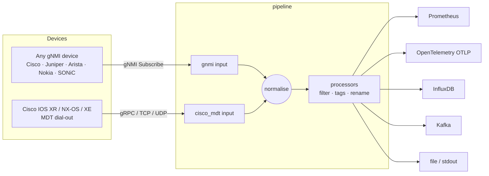

# Network Telemetry Pipeline

**pipeline** collects *streaming telemetry* from network devices and delivers
it to the monitoring systems you already run.

## Why streaming telemetry?

SNMP polling asks each device "what are your counters?" every few minutes.
Streaming telemetry flips that around: the device **pushes** structured,
model-driven data (YANG) every few seconds, or the instant something changes.
You get higher resolution, less load on the device's control plane, and data
that is already structured.

The hard part is the plumbing in between: talking each device's protocol,
decoding its encoding, reshaping hierarchical YANG data into something a
time-series database understands, and doing it reliably at scale. That is
what this project does.

## What it does

- **Collects** with gNMI (the vendor-neutral standard) or Cisco Model-Driven
  Telemetry dial-out (gRPC, TCP or UDP).
- **Normalises** every vendor, transport and encoding into one simple metric
  model: a *name*, *tags* that identify the instance, *fields* that hold the
  values, and a *timestamp*.
- **Processes**: filters what you don't need, enriches with inventory tags
  such as site and role, renames to match your dashboards.
- **Delivers** to Prometheus, any OpenTelemetry backend, InfluxDB 1.x/2.x/3.x,
  Kafka, or JSON files, in parallel, with batching, retries and per-destination
  isolation.

## Where to start

| You are… | Start here |
|---|---|
| Trying it out | [Quickstart](getting-started/quickstart.md): see real router data in Prometheus in five minutes, no router needed |
| Deploying it | [Installation](getting-started/installation.md), then [Connect your first device](getting-started/first-device.md) |
| Configuring it | [Configuration overview](configuration/overview.md) |
| Running it in production | [Deployment](operations/deployment.md) and [Monitoring the pipeline](operations/monitoring.md) |
| Joining as a developer | [Developer onboarding](development/onboarding.md) |
| Coming from the 2016 version | [Modernization & migration](about/modernization.md) |
